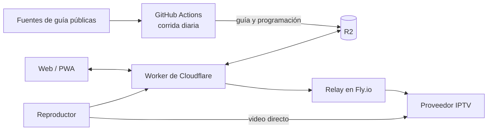

# nowline

**nowline** (antes Grilla) es un organizador de listas IPTV: conectás tu proveedor, la app cruza cada canal con la
guía de programación correcta, vos corregís lo que haga falta desde el celular o la compu, y copiás dos links
(playlist y guía) para tu reproductor, como TiviMate. El video nunca pasa por nowline: es solo el organizador.

No hay cuentas. Cada persona tiene una configuración anónima con una clave de edición en su navegador; el usuario y la
contraseña del proveedor viajan cifrados dentro de los links y no se guardan en ningún lado.

Qué hace hoy:

- **Canales:** la lista del proveedor con la guía elegida por canal, nombres, categorías, orden y ocultos; muestra lo que
  falta revisar y sugiere guías con el matcher.
- **Guía:** grilla de canales por hora, búsqueda y **Tu plan** (lo que solés mirar, con el porqué y «Más como esto»).
- **Perfil:** varias cuentas y perfiles por proveedor, links por dispositivo, vencimiento y conexiones en uso, canales
  caídos.
- **Modo «solo ver»:** un código para que otra persona mire la grilla y la Guía sin poder cambiar nada.
- **Avisos** de canales nuevos, de vencimiento y recordatorios de programas; se instala como app (PWA).

## Cómo está armado

Dos mitades que se encuentran en un bucket de Cloudflare R2:



- **Lo compartido, una vez al día:** GitHub Actions baja las fuentes de guía, las fusiona, arma el índice, la
  programación y una guía por configuración. No usa credenciales de ningún proveedor.
- **Lo de cada persona, al momento:** un Worker sirve la web, la API y los links; el relay (con una IP que el proveedor
  no bloquea) baja la lista y prueba los canales.

Los diagramas completos (corrida diaria, modelo de datos, reproducción, mapa de R2) están en
**[`docs/arquitectura.md`](docs/arquitectura.md)**.

## Dónde está cada cosa

| Carpeta o archivo | Qué es |
|---|---|
| `merge_epgs.py`, `epg_urls.json`, `epg_sources_catalog.json` | fusión de las fuentes de guía y su catálogo |
| `generate_playlist.py`, `epg_index.py`, `channel_names.py`, `channel_db.py` | índice de la guía, matcher y programación |
| `shared_guide.py`, `source_alias.py` | lo que se publica en R2, con las fuentes enmascaradas |
| `providers.py`, `xtream_client.py`, `profiles.py` | proveedores (Xtream, M3U) y perfiles de la corrida (opcionales) |
| `matching_rules.json`, `playlist_sections.json`, `provider_rules.json`, `xtream_channel_map.json` | reglas del matcher, secciones, reglas del proveedor y overrides |
| `core/` | `@grilla/core`: el mismo matcher en TypeScript, para el navegador |
| `worker/` | el Worker y la web (Preact); versión en `worker/package.json` |
| `relay/` | el relay, un contenedor Python chico |
| `tools/` | herramientas de la corrida: fuentes automáticas, empaque, consumo, IA, medición |
| `tests/`, `bench/` | tests de Python y banco de pruebas del matcher |
| `docs/` | arquitectura y referencia del pipeline |
| `planes/` | planes y decisiones, con su estado |
| `.github/workflows/` | la corrida diaria y el resto de los workflows |
| `CHANGELOG.md` | novedades de la web, por versión |

## Uso local

```bash
pip install -r requirements.txt
python merge_epgs.py            # fusiona las fuentes → merged.xml.gz
python generate_playlist.py     # programación y catálogo (el cruce por perfil es opcional)
python -m pytest tests/ -q      # tests de Python
```

La web y el Worker (más detalle en [`worker/README.md`](worker/README.md)):

```bash
cd worker && npm install && node build.mjs   # compilar la web a public/
npm test                                     # tests del Worker
npm run check                                # tipos del Worker y de la web
npx wrangler dev --local                     # todo junto en http://localhost:8787
```

## La corrida diaria

`merge-epgs.yml` corre a las 17:30 UTC (y a mano): tests → fuentes automáticas → fusión → programación y catálogo →
guía compartida y guía de cada configuración a R2 → medición de títulos → release. `refresh-lists.yml` arma cada 3 horas
la guía de las configuraciones nuevas o editadas. El Worker corre su propio cron cada 30 minutos (avisos y canales
caídos). La lista de workflows está en [`docs/pipeline-epg.md`](docs/pipeline-epg.md#workflows).

## Reglas del proyecto

Están en [`CLAUDE.md`](CLAUDE.md). Las principales:

- Todo PR que cambia la interfaz actualiza su ayuda (temas de `worker/web/index.html`, textos `<Help>` y la ayuda del modo
  ver).
- Todo PR que cambia la web sube la versión en `worker/package.json` y agrega su entrada en `CHANGELOG.md`.
- Un PR propio con el CI en verde, sin conflictos y sin comentarios pendientes se mergea solo (squash).
- Los links de reproducción (`short/` y `devices/` en R2) nunca se borran ni se invalidan.
- Ninguna fuente de guía se nombra en la interfaz, el XML, las playlists ni los archivos públicos.
- Si se cambia el matcher de Python, el mismo cambio va en `core/src/` y se regenera el fixture de paridad.

## Más documentación

- [`docs/arquitectura.md`](docs/arquitectura.md): cómo está armado el sistema, con diagramas.
- [`docs/pipeline-epg.md`](docs/pipeline-epg.md): fuentes de guía, fuentes automáticas, matcher, overrides y reglas.
- [`worker/README.md`](worker/README.md): la API, la web, puesta en marcha y avisos push.
- [`relay/README.md`](relay/README.md): el relay y cómo publicarlo.
- [`core/README.md`](core/README.md): el matcher en TypeScript y su paridad con Python.
- [`planes/`](planes/README.md): planes y decisiones, con su estado.
