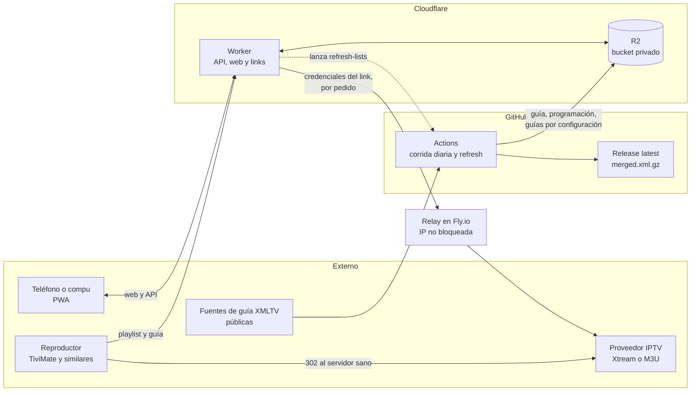
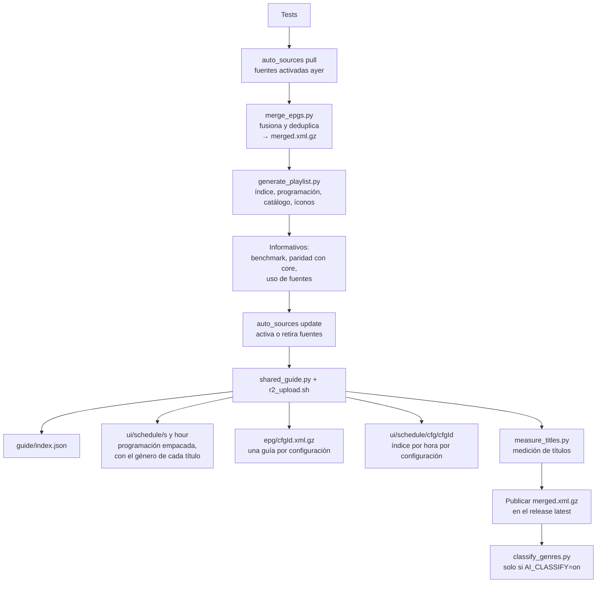
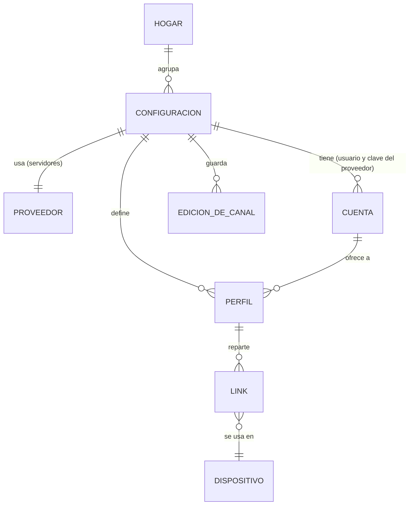
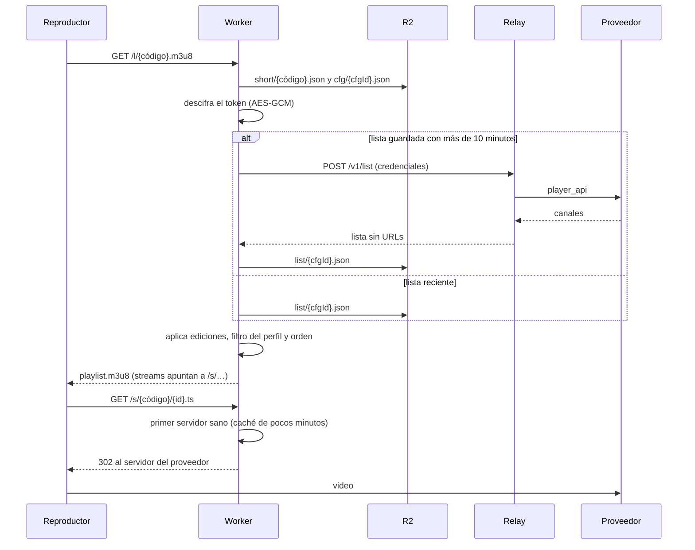
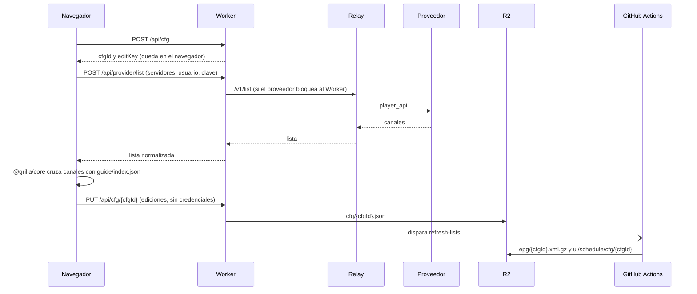

# Arquitectura de Nowline

Vista de conjunto de cómo está armado el sistema hoy (octubre de 2026): qué corre dónde, cómo viajan los datos y qué
es de cada persona y qué es de todos. Los diagramas son [Mermaid](https://mermaid.js.org/) y GitHub los dibuja solo.

Detalle por parte: el pipeline de EPG en [`pipeline-epg.md`](pipeline-epg.md), la API y la web en
[`../worker/README.md`](../worker/README.md), el relay en [`../relay/README.md`](../relay/README.md), el matcher
en TypeScript en [`../core/README.md`](../core/README.md). Las decisiones y planes históricos están en
[`../planes/`](../planes/README.md).

## 1. Qué es

Nowline (antes Grilla) es una interfaz para ordenar la lista de canales de un proveedor IPTV y darle a cada canal la
guía de programación correcta. Es **solo organizador**: entrega links (playlist y guía) a un reproductor como TiviMate;
el video nunca pasa por Nowline. No tiene cuentas de usuario: cada persona tiene una configuración anónima con una clave
de edición en su navegador.

Dos mitades que se tocan en R2:

- **Lo compartido (una vez al día, igual para todos):** bajar las fuentes de guía públicas, fusionarlas, indexar y armar
  la programación de toda la guía. Corre en GitHub Actions.
- **Lo de cada persona (al momento):** su lista, sus ediciones, sus links, sus canales caídos y su vencimiento. Corre en
  un Cloudflare Worker, con un relay chico para hablar con el proveedor.

## 2. Vista general

Lo que importa de este dibujo:

- **El Worker no le habla directo al proveedor** (bloquea las IPs de Cloudflare): lista, canales caídos y vencimiento
  van por el relay. El reproductor sí habla directo con el proveedor, porque el Worker responde un redirect 302 al primer
  servidor sano.
- **Las credenciales nunca se guardan.** Viajan cifradas (AES-GCM) dentro del token del link; el Worker las descifra al
  servir, se las pasa al relay y las descarta.
- **R2 es el punto de encuentro.** Actions escribe la guía; el Worker lee la guía y escribe lo de cada persona.

## 3. La corrida diaria (`merge-epgs.yml`)

Corre a las 17:30 UTC (puede atrasarse) y a mano. Toda ella es compartida: **no usa ninguna credencial de proveedor**.

- **Fusión (`merge_epgs.py`):** lee cada fuente en streaming y deduplica por (canal, inicio) en SQLite temporal; así usa
  ~1,4 GB aunque la guía llegue a 3 millones de programas.
- **`generate_playlist.py`:** indexa los canales de la guía y recorre los programas una vez para armar la programación
  de la interfaz (ventana de -1 h a +30 h). Con perfiles configurados (opcional) también cruza la lista de esa cuenta.
- **Subida a R2:** `tools/r2_sync.py` sube solo lo que cambió y en gzip; `tools/pack_schedule.py` empaca la
  programación en 256 tandas para no hacer miles de escrituras por día.
- **Guía y índice por configuración:** `tools/config_epgs.py` abre una guía por cada `cfg/<cfgId>.json` y recorre la
  guía fusionada **una sola vez** escribiendo todas a la vez. Cada una lleva los canales de guía elegidos en esa
  configuración.
- **`refresh-lists.yml`** (cada 3 horas y cuando el Worker la pide) arma solo las guías de configuraciones nuevas o
  editadas, para que una persona nueva no espere a la corrida del día siguiente.
- **Fuentes automáticas:** la demanda sale de los canales sin guía de las configuraciones; se activan las fuentes del
  catálogo que más suman por MB, con tope, y se retiran las que nadie usa.
- **IA (apagada por defecto):** `classify_genres.py` etiqueta cada título nuevo con género y temas (Claude Haiku 5.5 por
  lotes), se guarda una vez por título en R2 y Tu plan lo usa. Detalle en [`../planes/ia-tu-plan.md`](../planes/ia-tu-plan.md).

## 4. El Worker (`worker/`)

Un solo Worker sirve la web estática, la API y los links de reproducción. TypeScript sin dependencias de runtime en el
servidor; la web es Preact compilada con esbuild.

| Grupo | Rutas | Para qué |
|---|---|---|
| Configuración | `POST /api/cfg`, `GET/PUT/DELETE /api/cfg/<cfgId>` | alta, ediciones y baja de una configuración (clave de edición en `Authorization`) |
| Lista | `POST /api/provider/list`, `PUT/GET /api/cfg/<cfgId>/list` | lista del proveedor de paso, o subida a mano si el proveedor bloquea |
| Links | `POST /api/cfg/<cfgId>/token`, devices, `…/move` | credenciales → token cifrado, links cortos por dispositivo |
| Reproducción | `/p/<cfgId>/<token>/playlist.m3u8`, `/s/<…>/<id>.<ext>`, `/l/<código>.m3u8`, `/g/<código>.xml.gz` | playlist en vivo, redirect al servidor sano, guía |
| Guía | `/api/guide/index.json`, `/api/cfg/<cfgId>/hour/<hora>.json`, `/api/ui/schedule/…` | índice para `@grilla/core` y programación |
| Medios | `/logo/<clave>`, `/img/<clave>` | logos e imágenes sin mostrar de qué sitio vienen |
| Perfiles y ver | `…/profiles`, `/api/view/<código>…` | perfiles de una cuenta y modo «solo ver» |
| Tu plan | `…/habits`, `…/reports`, `/api/ui/again` | hábitos, reportes de guía que no coincide, «llegás desde el principio» |
| Avisos | `…/push`, recordatorios | Web Push de canales nuevos y recordatorios |
| Hogar | `/api/home…` | varias configuraciones de una persona bajo una sola clave |

La lista completa y comentada está al principio de `worker/src/index.ts`.

**Cron del Worker (cada 30 minutos):** revisa los canales nuevos de quienes activaron avisos (`push.ts`) y prueba los
canales caídos y el vencimiento de cada cuenta por el relay (`streamcheck.ts`, una vez por día por configuración o
cuando alguien toca «Probar ahora»).

## 5. Modelo de datos de una persona

- **Configuración (`cfgId`):** lo que una persona edita sobre la lista de un proveedor: la guía elegida por canal,
  renombres, categorías, ocultos, orden y reglas. No lleva usuario ni contraseña. Tiene una **clave de edición** (se
  guarda su hash) que vive en el navegador y se puede exportar como respaldo.
- **Cuenta:** usuario y contraseña del proveedor. Nunca se guardan: van cifradas dentro del token de cada link. De la
  cuenta salen el vencimiento y las conexiones en uso, y la «cuenta en uso» define con cuál se baja la lista y se
  prueban canales.
- **Perfil:** dentro de una cuenta, un nombre y «qué ve» (filtro de categorías y canales).
- **Link:** un código corto (`short/<código>.json`) con su token. Un link se puede reutilizar en varios dispositivos y
  se puede desactivar sin borrarlo. **Los links de reproducción nunca se borran ni se invalidan** (`short/`, `devices/`).
- **Hogar:** todas las configuraciones de una persona bajo una sola clave, para abrir Nowline en otro dispositivo.
- **Modo «solo ver»:** un código `ver.<código>` por perfil para que otra persona mire la grilla y la Guía sin poder
  cambiar nada.

## 6. Qué pasa cuando el reproductor pide la playlist

El video va directo del proveedor al reproductor. Para el Worker, un servidor que responde 403 cuenta como vivo: el
proveedor bloquea a Cloudflare, no al reproductor.

## 7. Alta de una configuración

El cruce automático de canales con la guía corre **en el navegador** (`core/`, el mismo matcher que Python, con test de
paridad), así el Worker entra en el plan gratis (10 ms de CPU por pedido).

## 8. El relay (`relay/`)

Servicio Python chico en un contenedor con IP que el proveedor no bloquea. Recibe credenciales por HTTPS con un secreto
compartido, hace el pedido y las descarta; no guarda nada ni las escribe en el log.

| Pedido | Para qué |
|---|---|
| `POST /v1/list` | la lista de canales |
| `POST /v1/account` | vencimiento, conexiones y zona horaria del panel |
| `POST /v1/probe` | probar hasta 60 canales y medir su resolución |
| `GET /health` | está vivo |

## 9. Mapa de R2

Un bucket privado (`grilla`). Nada se sirve directo: todo pasa por el Worker.

| Prefijo | Qué hay | Lo escribe |
|---|---|---|
| `guide/index.json` | canales, fuentes (con alias) y reglas para `@grilla/core` | corrida diaria |
| `ui/schedule/s/<xx>`, `ui/schedule/hour/` | programación por canal (256 tandas) y por hora | corrida diaria |
| `ui/schedule/cfg/<cfgId>` | índice por hora de los canales de una configuración | corrida diaria, refresh |
| `epg/<cfgId>.xml.gz` | guía de una configuración | corrida diaria, refresh |
| `logo/map/`, `img/map/`, `logo/img/` | mapas privados de logos e imágenes, y logos guardados | corrida diaria y Worker |
| `cfg/<cfgId>.json` | configuración (sin credenciales) | Worker |
| `list/<cfgId>.json`, `relaylist/` | última lista del proveedor, sin URLs ni credenciales | Worker |
| `short/<código>.json`, `devices/<cfgId>.json` | links de reproducción y su lista por configuración | Worker |
| `home/`, `view/`, `push/`, `remind/`, `habits/`, `reports/`, `play/` | hogar, modo ver, avisos, recordatorios, hábitos, reportes, último uso | Worker |
| `health/`, `healthreq/`, `healthprog/`, `healthstop/` | canales caídos y cuenta, y los pedidos de prueba | Worker |
| `state/auto_sources.json` | fuentes automáticas activas | corrida diaria |
| `ai/` | medición, caché de géneros, gasto y lotes pendientes de la IA | corrida diaria |

**Regla fija:** `short/` y `devices/` (los links de reproducción) nunca se borran ni se alteran. Cambiar `TOKEN_KEY`
también los invalida, así que no se rota.

## 10. La web

Preact, compilada por `worker/build.mjs` a `public/` y servida por el mismo Worker. Es una PWA
instalable con service worker. Las pantallas nuevas viven en `worker/web/ui/*.tsx`; `worker/web/app.ts` conserva los
gestos como listeners delegados.

| Pestaña | Para qué |
|---|---|
| **Canales** | la lista del proveedor, con lo que falta revisar; hoja de cada canal para elegir guía, nombre y categoría |
| **Guía** | grilla de canales por hora, búsqueda, «Tu plan» con lo que sueles mirar y «Más como esto» |
| **Categorías** | orden, ocultar y marcar «Sin guía» |
| **Perfil** | cuentas, perfiles, links, dispositivos, vencimiento y conexiones |

Además: Configuración (tema, avisos, letra grande, fuentes de EPG), el modo «solo ver» (`/ver`) para quien solo mira, y los diseños
claro y oscuro con tokens en `worker/web/tokens.css`. Cada cambio de interfaz actualiza su ayuda (ver `CLAUDE.md`).

## 11. Secretos y variables

| Dónde | Nombre | Para qué |
|---|---|---|
| GitHub (secreto) | `R2_ACCOUNT_ID`, `R2_ACCESS_KEY_ID`, `R2_SECRET_ACCESS_KEY` | subir a R2 |
| GitHub (secreto) | `ANTHROPIC_API_KEY` | clasificación con IA |
| GitHub (secreto) | `CLOUDFLARE_ANALYTICS_TOKEN`, `FLY_READ_TOKEN` | registro de consumo |
| GitHub (variable) | `R2_BUCKET`, `AI_CLASSIFY` | nombre del bucket e interruptor de la IA (`on`) |
| Worker (secreto) | `TOKEN_KEY` | cifrar las credenciales de los links |
| Worker (secreto) | `RELAY_URL`, `RELAY_SECRET` | hablar con el relay |
| Worker (secreto) | `GITHUB_TOKEN` | lanzar `refresh-lists` al instante (opcional) |
| Worker (secreto) | `VAPID_PRIVATE_KEY`, `VAPID_PUBLIC_KEY`, `VAPID_SUBJECT` | avisos push |
| Relay (secreto) | `RELAY_SECRET` | autenticar al Worker |

Ninguna credencial de un proveedor ni de una persona vive en GitHub. Los secretos `XTREAM_*` de antes ya no se usan.

## 12. Reglas de diseño que se mantienen

- **Sin cuentas:** configuración anónima con clave de edición en el navegador; la clave se exporta como respaldo.
- **Credenciales fuera del servidor:** solo cifradas dentro del link; el relay las usa y las descarta.
- **Sin rastro de las fuentes de guía:** ids y fuentes con alias opacos, logos e imágenes por el Worker, nada con nombres
  o URLs de fuentes en la interfaz, el XML, las playlists ni los archivos públicos (`source_alias.py`).
- **Lo compartido se calcula una vez:** la corrida no se multiplica por usuario; lo de cada persona se deriva en una
  pasada.
- **Un solo matcher:** Python y `core/` tienen que dar lo mismo; un cambio en uno se replica en el otro y se regenera el
  fixture de paridad.
- **Los links de reproducción son sagrados:** nunca se borran ni se invalidan.
- **Dentro de los planes gratis:** Worker (10 ms de CPU por pedido), R2 (10 GB, escrituras de clase A) y Actions. El
  registro de consumo (`consumo.yml`, issue «Consumo de servidores») avisa al pasar el 70 %.

## 13. Límites conocidos y pendientes de escala

Ver [`../planes/arquitectura-por-usuario.md`](../planes/arquitectura-por-usuario.md): la pasada por configuración crece
con programas × configuraciones y falta medirla con cientos o miles; no se dejan de armar las guías de configuraciones
sin uso; falta decidir el tope de usuarios antes de pagar algo.
